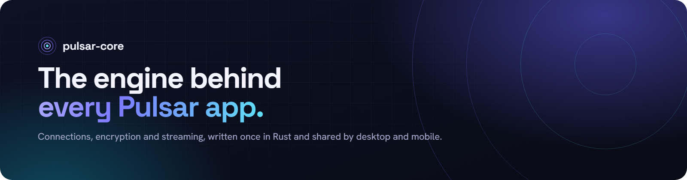
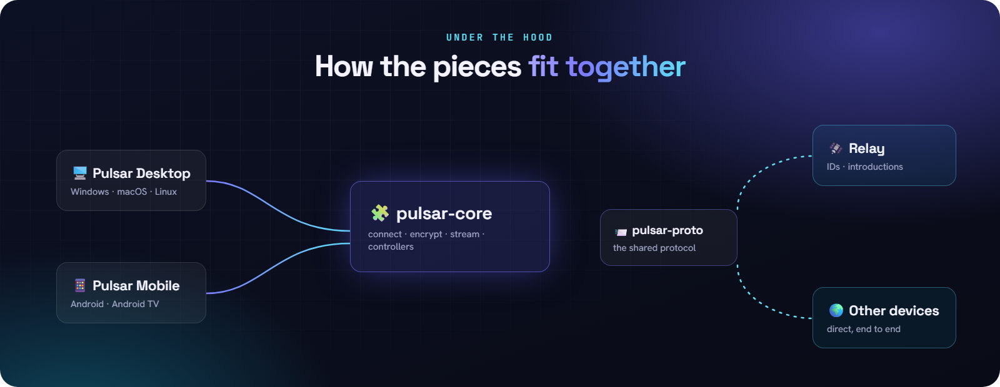

<p align="center">
  <a href="https://pulsardesk.com"></a>
</p>

<h3 align="center">The engine inside every Pulsar app.</h3>

<p align="center">
  Connecting, encrypting and streaming, written once in Rust and shared by
  <a href="https://github.com/PulsarDesk/pulsar-desktop">Pulsar Desktop</a> and
  <a href="https://github.com/PulsarDesk/pulsar-mobile">Pulsar Mobile</a>.<br>
  When this gets faster or safer, every Pulsar app does too.
</p>

<p align="center">
  <a href="https://github.com/PulsarDesk/pulsar-core/releases"></a>
  <a href="https://github.com/PulsarDesk/pulsar-core/actions/workflows/ci.yml"></a>
  <a href="https://github.com/PulsarDesk/pulsar-core/stargazers"></a>
  
  <a href="LICENSE"></a>
</p>

> [!TIP]
> **Looking for the app?** This is a library for developers. To use Pulsar, get
> **[Pulsar Desktop](https://github.com/PulsarDesk/pulsar-desktop)** (Windows, macOS, Linux) or
> **[Pulsar Mobile](https://github.com/PulsarDesk/pulsar-mobile)** (Android).

## 🧩 Where it fits

<p align="center"></p>

Both apps are a shell (windows, buttons, settings) around this engine. Everything that has to behave the same on a
laptop and a phone lives here, so a fix lands everywhere at once.

## ⚙️ What's inside

<table>
<tr>
<td width="50%" valign="top">

### 🤝 Connecting
Device IDs, finding devices on your network, and a **direct connection first**: NAT punching, automatic router
port mapping (UPnP / NAT-PMP), with the relay as an automatic fallback. Keeps a session alive when the network
changes under it.

</td>
<td width="50%" valign="top">

### 🔒 Encryption
**End-to-end, always on.** A password-authenticated key exchange (PAKE) with forward secrecy, so the relay only
ever forwards data it can't read. Two-factor (TOTP) codes for access control.

</td>
</tr>
<tr>
<td width="50%" valign="top">

### 🎞️ Streaming
Screen capture and hardware encoding per OS, H.264 / H.265 / AV1, and a stream that **adapts to the link**:
bitrate, resolution, error correction (Reed-Solomon FEC) and fast loss recovery. Opus audio.

</td>
<td width="50%" valign="top">

### 🎮 Input and controllers
Mouse, keyboard and touch on the host, plus virtual controllers: Xbox 360, DualShock 4 and a full
**DualSense** with triggers, haptics and audio ([notes](docs/dualsense.md)). Ships the vendored `vigem-client`.

</td>
</tr>
</table>

Design notes: [adaptive streaming](docs/adaptive-streaming.md) · [DualSense](docs/dualsense.md).

## 🛠️ Use it

```bash
git clone https://github.com/PulsarDesk/pulsar-core.git
cd pulsar-core
cargo test
```

Add it as a git dependency (the Windows virtual gamepad needs the patch line too):

```toml
[dependencies]
pulsar-core = { git = "https://github.com/PulsarDesk/pulsar-core" }

[patch.crates-io]
vigem-client = { git = "https://github.com/PulsarDesk/pulsar-core" }
```

Pulsar is in **alpha** (0.x): the API changes as the apps need it.

## 🐞 Reporting a bug

Found a problem while **using** Pulsar? Report it in the app's repository
([desktop](https://github.com/PulsarDesk/pulsar-desktop/issues/new/choose) or
[mobile](https://github.com/PulsarDesk/pulsar-mobile/issues/new/choose)), even if you think the cause is here.
Open an issue in this repository only for problems with the library itself.

## 🌌 The Pulsar family

| | Project | |
|---|---|---|
| 🖥️ | [**Pulsar Desktop**](https://github.com/PulsarDesk/pulsar-desktop) | Pulsar for Windows, macOS and Linux |
| 📱 | [**Pulsar Mobile**](https://github.com/PulsarDesk/pulsar-mobile) | Pulsar for Android phones, tablets and TVs |
| 🛰️ | [**Pulsar Relay**](https://github.com/PulsarDesk/relay) | Run your own Pulsar server |
| 📨 | [**pulsar-proto**](https://github.com/PulsarDesk/pulsar-proto) | The protocol between apps and the relay |

## 🤝 Contributing

Everyone is welcome to open [issues](https://github.com/PulsarDesk/pulsar-core/issues) and pull requests.
Irrelevant or abusive issues may be closed or removed. Commits follow
[Conventional Commits](https://www.conventionalcommits.org).

## 📄 License

Pulsar is free software under the **GNU GPLv3 or later** (GPL-3.0-or-later). See [LICENSE](LICENSE).

<p align="center">
  <br>
  <b>Like Pulsar? A ⭐ helps other people find it.</b>
</p>
